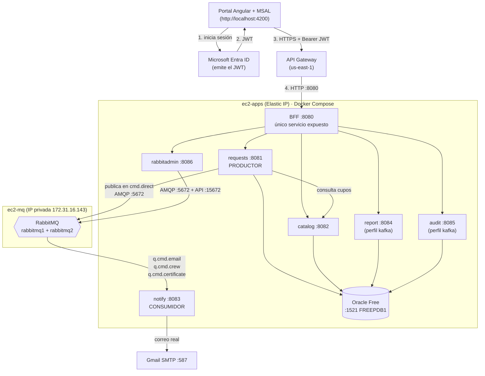

# barriodigital-infra

Infraestructura de **BarrioDigital**: los archivos `docker compose` que levantan el sistema completo y la documentación para operarlo en el AWS Academy Learner Lab.

El sistema son microservicios Java (Spring Boot) detrás de un BFF, con autenticación de Microsoft Entra ID (Azure), base de datos Oracle y mensajería con RabbitMQ.

## Contenido del repositorio

| Ruta | Qué contiene |
|---|---|
| `apps/compose.yml` | Oracle, BFF y microservicios (se despliega en **ec2-apps**) |
| `apps/.env.example` | Plantilla de variables de entorno de `ec2-apps` |
| `mq/compose.yml` | Clúster RabbitMQ de 2 nodos (se despliega en **ec2-mq**) |
| `mq/definitions.json` | Exchanges, colas, bindings y política de alta disponibilidad |
| `mq/.env.example` | Plantilla de variables de entorno de `ec2-mq` |
| `mq/README.md`, `docs/ec2-mq.md` | Detalle del clúster RabbitMQ y de la instancia que lo aloja |
| `docs/matriz-funcionalidades.md` | Matriz de funcionalidades: estado, componente y evidencia de cada una |
| `docs/guion-presentacion.md` | Guion de la presentación EP4: orden, comandos y preguntas probables |
| `kafka/compose.yml` | Clúster Kafka (pendiente: aún no forma parte del sistema desplegado) |

Los servicios se construyen desde sus propios repositorios, que deben estar clonados **junto a este** (`../../ms-barriodigital-*` desde `apps/`):

```text
~/barriodigital/
├── barriodigital-infra/          ← este repositorio
├── ms-barriodigital-bff/
├── ms-barriodigital-requests/
├── ms-barriodigital-catalog/
├── ms-barriodigital-notify/
├── ms-barriodigital-rabbitadmin/
├── ms-barriodigital-report/      (perfil kafka)
└── ms-barriodigital-audit/       (perfil kafka)
```

## Arquitectura



**Cómo viaja una petición.** El portal obtiene un JWT de Entra ID y lo envía a API Gateway, que reenvía todo (ruta comodín) al BFF en el puerto 8080. El BFF es el único servicio accesible desde fuera; los demás solo se alcanzan por la red interna de Docker. Cada servicio valida el JWT con el emisor de Entra ID y autoriza según el claim `roles` (`Admin`, `Operador`, `Auditor`; quien no tiene ninguno se trata como `Cliente`).

**Cómo viaja un aviso.** Cuando `requests` crea o cambia de estado un trámite, publica mensajes en el exchange `cmd.direct` de RabbitMQ (`email.send`, `crew.ticket`, `certificate.gen`). `notify` consume las colas `q.cmd.email`, `q.cmd.crew` y `q.cmd.certificate`; el correo se envía de verdad por SMTP y los otros dos destinos simulan el trabajo. Los mensajes que fallan van a las colas `q.cmd.*.dlq`.

## Puesta en marcha inicial

Solo la primera vez. Después de esto, cada ciclo del lab sigue la sección siguiente.

**ec2-mq**

```bash
cd ~/barriodigital/barriodigital-infra/mq
cp .env.example .env && chmod 600 .env     # edita los valores (usuario, clave y cookie de Erlang)
docker compose up -d
docker compose ps -a                       # rabbitmq-init debe quedar en Exited (0)
```

**ec2-apps**

```bash
cd ~/barriodigital/barriodigital-infra/apps
cp .env.example .env && chmod 600 .env     # edita los valores (ver "Variables de entorno")
docker compose up -d --build
```

El `.env` real **nunca se sube a git** (está en `.gitignore`); solo se versionan los `.env.example`. Usa letras y números en las contraseñas: `$` y `#` tienen significado especial en los archivos `.env`.

## Ciclo del Learner Lab (cada 4 horas)

### Orden de arranque

Siempre en este orden, porque los servicios de `ec2-apps` necesitan que RabbitMQ y Oracle estén listos.

1. **Inicia el lab** (*Start Lab*) y enciende las instancias `ec2-mq` y `ec2-apps` si aparecen detenidas.
2. **ec2-mq primero.** Con `restart: unless-stopped`, los contenedores `rabbitmq1` y `rabbitmq2` vuelven solos. Verifica que el clúster esté completo.
3. **ec2-apps después.** Oracle arranca primero (tarda cerca de 90 segundos hasta estar `healthy`); `requests`, `catalog`, `report` y `audit` esperan a que lo esté. `notify`, `rabbitadmin` y el BFF no dependen de Oracle.
4. **Verifica de punta a punta** con la lista de abajo.

Si algún contenedor no volvió por sí solo:

```bash
# en la instancia que corresponda, dentro de mq/ o de apps/
docker compose up -d
```

### Qué cambia tras cada reinicio

| Elemento | ¿Cambia? | Qué hacer |
|---|---|---|
| IP pública de **ec2-apps** | No: es una Elastic IP | Si en *EC2 → Elastic IPs* apareciera sin asociar, asóciala de nuevo a `ec2-apps` |
| Integración de **API Gateway** | No: apunta a la Elastic IP, puerto 8080 | Solo si falla la comprobación 4 de la lista de abajo: revisa que la integración siga apuntando a `http://<ELASTIC_IP>:8080` |
| IP privada de **ec2-mq** (`172.31.16.143`) | No: es estable entre reinicios | Si alguna vez cambiara, actualiza `RABBITMQ_HOST` en `apps/.env` y ejecuta `docker compose up -d` en `apps/` (recrea los contenedores con el valor nuevo) |
| IP pública de **ec2-mq** | **Sí** | Solo afecta al SSH y a la consola web. Léela en la consola de EC2 |
| IP del administrador en el *security group* de **ec2-mq** | Si tu IP de internet cambió | Edita la regla de entrada del puerto 15672 (`ec2-mq-rabbitmq`) con tu IP actual |

### Lista de verificación tras reiniciar

**1. Clúster RabbitMQ** (en `ec2-mq`):

```bash
docker ps --format "table {{.Names}}\t{{.Status}}"                 # rabbitmq1 y rabbitmq2: Up
docker exec rabbitmq1 rabbitmqctl cluster_status                   # ambos en "Running Nodes"
docker exec rabbitmq1 rabbitmqctl list_queues name policy messages consumers
```

Deben aparecer las seis colas `q.cmd.*` con la política `ha-cmd`.

**2. Servicios** (en `ec2-apps`):

```bash
docker ps --format "table {{.Names}}\t{{.Status}}"                 # todos Up; oracle-db, notify y rabbitadmin además "(healthy)"
docker logs --tail 5 ms-barriodigital-notify                       # debe mostrar "Consumidor suscrito a las colas ..."
curl -s http://localhost:8086/actuator/health                      # {"status":"UP"}
```

**3. Conexión de requests con RabbitMQ y Oracle:**

```bash
docker logs --tail 20 ms-barriodigital-requests | grep -i -E "Started|ERROR"
```

**4. Cadena API Gateway → BFF** (desde cualquier equipo):

```bash
curl -i https://<API_ID>.execute-api.us-east-1.amazonaws.com/<stage>/api/catalog/procedures
```

Debe responder **401** (sin token). El 401 lo devuelve el JWT Authorizer del API Gateway o, si la petición lo supera, el BFF. Un 5xx o un tiempo de espera indica que API Gateway no alcanza `ec2-apps:8080`.

## Puertos

| Servicio | Instancia | Puerto | Expuesto |
|---|---|---|---|
| BFF (`ms-barriodigital-bff`) | ec2-apps | 8080 | **Sí**, lo consume API Gateway |
| requests | ec2-apps | 8081 | No (red interna) |
| catalog | ec2-apps | 8082 | No (red interna) |
| notify | ec2-apps | 8083 | No (red interna; healthcheck interno) |
| report *(perfil kafka)* | ec2-apps | 8084 | No |
| audit *(perfil kafka)* | ec2-apps | 8085 | No |
| rabbitadmin | ec2-apps | 8086 | Solo `127.0.0.1` del host; el acceso real es por el BFF (`/api/rabbit`) |
| Oracle (`oracle-db`) | ec2-apps | 1521 | No (red interna; servicio `FREEPDB1`) |
| RabbitMQ nodo 1: AMQP / consola web | ec2-mq | 5672 / 15672 | AMQP solo desde el *security group* de ec2-apps; consola solo desde la IP del administrador |
| RabbitMQ nodo 2: AMQP / consola web | ec2-mq | 5673 / 15673 | Igual que el nodo 1 |
| Portal Angular | equipo local | 4200 | Solo local (`npm start`) |

## Variables de entorno

Todas se definen en el `.env` de la instancia correspondiente. `docker compose` se niega a arrancar si falta una obligatoria y dice cuál.

### `apps/.env` (ec2-apps)

| Variable | Obligatoria | La usan | Descripción |
|---|---|---|---|
| `AZURE_TENANT_ID` | Sí | Todos los servicios Java | Directorio de Entra ID; define el emisor del JWT (`https://login.microsoftonline.com/<tenant>/v2.0`) |
| `DB_USER` | Sí | requests, catalog, report, audit, oracle-db | Usuario de la aplicación en Oracle |
| `DB_PASSWORD` | Sí | requests, catalog, report, audit, oracle-db | Clave de ese usuario |
| `ORACLE_PASSWORD` | Sí | oracle-db | Clave del administrador de Oracle (`SYS`/`SYSTEM`) |
| `RABBITMQ_HOST` | Sí | requests, notify, rabbitadmin | IP privada de ec2-mq. También forma la URL de gestión `http://<host>:15672` de rabbitadmin |
| `RABBITMQ_PORT` | No (5672) | requests, notify, rabbitadmin | Puerto AMQP |
| `RABBITMQ_USER` | Sí | requests, notify, rabbitadmin | Debe ser igual a `RABBITMQ_DEFAULT_USER` de `mq/.env` |
| `RABBITMQ_PASSWORD` | Sí | requests, notify, rabbitadmin | Debe ser igual a `RABBITMQ_DEFAULT_PASS` de `mq/.env` |
| `MAIL_ENABLED` | No (`false`) | notify | `true` envía correos reales por SMTP; `false` solo los simula en el log |
| `MAIL_USERNAME` | Si `MAIL_ENABLED=true` | notify | Cuenta que envía (usuario SMTP) |
| `MAIL_PASSWORD` | Si `MAIL_ENABLED=true` | notify | Clave de aplicación de esa cuenta (no la clave normal) |
| `MAIL_FROM` | No | notify | Remitente; por defecto es `MAIL_USERNAME` |
| `MAIL_HOST` / `MAIL_PORT` | No | notify | Servidor SMTP; por defecto `smtp.gmail.com` / `587` (STARTTLS) |

El compose fija el resto: `SERVER_PORT` de cada servicio, las URLs internas (`*_SERVICE_URL` del BFF) y la conexión a Oracle (`jdbc:oracle:thin:@oracle-db:1521/FREEPDB1`).

### `mq/.env` (ec2-mq)

| Variable | Obligatoria | Descripción |
|---|---|---|
| `RABBITMQ_DEFAULT_USER` | Sí | Usuario de la aplicación. Se crea solo en el **primer** arranque, con el volumen vacío |
| `RABBITMQ_DEFAULT_PASS` | Sí | Clave de ese usuario |
| `RABBITMQ_ERLANG_COOKIE` | Sí | Cookie del clúster: debe ser la misma en ambos nodos. Usa una cadena larga y aleatoria |

Para cambiar el usuario o la clave después del primer arranque hay que recrear los volúmenes (`docker compose down -v`), lo que borra las colas y los mensajes.

## Pruebas manuales

### Obtener un token

El token se copia de una sesión iniciada en el portal:

1. Arranca el portal (`npm start` en `frontend-barriodigital`) e inicia sesión con el usuario con el que quieras probar (el rol del token es el del usuario).
2. Abre las herramientas de desarrollador del navegador (F12) → pestaña **Network**.
3. Navega a cualquier pantalla que cargue datos, haz clic en una petición a `/api/...` y copia el valor de la cabecera `Authorization`, sin la palabra `Bearer`.

El token caduca en cerca de una hora. Trátalo como una contraseña: no lo pegues en chats, issues ni archivos versionados.

### Peticiones de ejemplo

```bash
API=https://<API_ID>.execute-api.us-east-1.amazonaws.com/<stage>
TOKEN='<pega aquí el token>'

# Catálogo de trámites (Cliente: solo activos; Operador y Admin: todos)
curl -s -H "Authorization: Bearer $TOKEN" "$API/api/catalog/procedures"

# Mis solicitudes (el Cliente ve solo las suyas; el personal ve todas)
curl -s -H "Authorization: Bearer $TOKEN" "$API/api/requests"

# Crear una solicitud como Cliente (el correo se toma del token)
curl -s -X POST -H "Authorization: Bearer $TOKEN" -H "Content-Type: application/json" \
     -d '{"procedureId": 1, "description": "Poda de árbol frente a mi casa"}' "$API/api/requests"

# Cambiar el estado (Operador o Admin)
curl -s -X PUT -H "Authorization: Bearer $TOKEN" -H "Content-Type: application/json" \
     -d '{"status": "ADMITIDO"}' "$API/api/requests/<id>/status"

# Colas de RabbitMQ (solo Admin)
curl -s -H "Authorization: Bearer $TOKEN" "$API/api/rabbit/queues"
```

En PowerShell usa `curl.exe` (no `curl`, que es un alias de otra cosa) y define las variables con `$API = '...'` y `$TOKEN = '...'`. Sin token las rutas responden **401**; con el rol equivocado, **403**.

### Ver el recorrido de un mensaje

```bash
# ec2-apps: el mensaje sale de requests...
docker logs -f ms-barriodigital-requests | grep "Evento publicado"
# ...y notify lo consume y envía el correo
docker logs -f ms-barriodigital-notify | grep -E "Correo enviado|duplicado|Reintento"
```

### Consola web de RabbitMQ (Management UI)

- Nodo 1: `http://<IP pública de ec2-mq>:15672`; nodo 2: `http://<IP pública de ec2-mq>:15673`.
- Entra con el usuario y la clave de `mq/.env`. En la pestaña **Queues** se ven las seis colas, sus consumidores y los mensajes que llegan a las colas `*.dlq`.
- Si no abre, revisa que tu IP actual esté en la regla del puerto 15672 del *security group* `ec2-mq-rabbitmq` y que la IP pública sea la actual (cambia en cada reinicio).

## Kafka (pendiente)

`report` y `audit` pertenecen al perfil `kafka` de `apps/compose.yml` y no arrancan por defecto. Se activarán con `docker compose --profile kafka up -d` cuando exista el broker y se agreguen sus variables de conexión.
