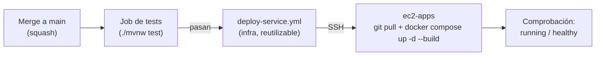

# Despliegue automático (GitHub Actions → ec2-apps)

Cada vez que se fusiona un cambio en `main` de un servicio, GitHub Actions ejecuta los tests y, si pasan, redespliega **solo ese servicio** en `ec2-apps` por SSH. Los cambios de `apps/compose.yml` también se aplican solos. `ec2-mq` (clúster RabbitMQ) **no** se despliega automáticamente: se actualiza a mano.



## Piezas

| Archivo | Dónde | Qué hace |
|---|---|---|
| `.github/workflows/deploy-service.yml` | este repo | Workflow **reutilizable**: entra por SSH, hace `git pull --ff-only`, `docker compose up -d --build <servicio>` y verifica que el contenedor quede `running`/`healthy` |
| `.github/workflows/deploy-infra.yml` | este repo | Al cambiar `apps/**` en `main`: valida el compose y ejecuta `docker compose up -d` (recrea solo lo que cambió) |
| `.github/workflows/ci-cd.yml` | cada microservicio y el frontend | Tests en cada push y pull request; el job `deploy` llama a `deploy-service.yml` solo en push a `main` |

- **Pull requests:** solo corren los tests; nunca despliegan.
- **Despliegues en serie:** el grupo `deploy-ec2-apps` evita que dos `docker compose` corran a la vez.
- **Tests:** se excluyen los `*ApplicationTests` (cargan el contexto completo y requieren Oracle/RabbitMQ reales); el resto sí se ejecuta.
- **report y audit** (perfil `kafka`, aún sin desplegar): su workflow solo ejecuta tests.
- **Frontend:** compila con `ng build --configuration production` y luego redespliega `frontend-barriodigital`.

## Secretos requeridos

Se definen **en cada repositorio** (los repos son de una cuenta personal, así que no se pueden heredar):

| Secreto | Contenido |
|---|---|
| `EC2_HOST` | IP elástica de `ec2-apps` |
| `EC2_USER` | `ec2-user` |
| `EC2_SSH_KEY` | Llave privada completa (`.pem`) con la que se entra a `ec2-apps` |
| `EC2_KNOWN_HOSTS` | Salida de `ssh-keyscan -t ed25519 <EC2_HOST>` (huella del servidor; evita conectarse a un host falso) |

Carga con la CLI de GitHub (PowerShell). Se repite para los 9 repositorios (infra, bff, requests, catalog, notify, rabbitadmin, report, audit y frontend):

```powershell
$ip      = "<IP elástica de ec2-apps>"
$pem     = "C:\ruta\a\llave.pem"
$hostkey = (ssh-keyscan -t ed25519 $ip 2>$null) -join "`n"
$repos   = @(
  "ManuelCaceresDuocUC/barriodigital-infra",
  "ManuelCaceresDuocUC/barrioDigital-ms-barriodigital-bff",
  "ManuelCaceresDuocUC/barrioDigital-ms-barriodigital-requests",
  "ManuelCaceresDuocUC/barrioDigital-ms-barriodigital-catalog",
  "ManuelCaceresDuocUC/barrioDigital-ms-barriodigital-notify",
  "ManuelCaceresDuocUC/barrioDigital-ms-barriodigital-rabbitadmin",
  "ManuelCaceresDuocUC/barrioDigital-ms-barriodigital-report",
  "ManuelCaceresDuocUC/barrioDigital-ms-barriodigital-audit",
  "ManuelCaceresDuocUC/frontend-barriodigital"
)
foreach ($r in $repos) {
  gh secret set EC2_HOST        --repo $r --body $ip
  gh secret set EC2_USER        --repo $r --body "ec2-user"
  gh secret set EC2_KNOWN_HOSTS --repo $r --body $hostkey
  Get-Content -Raw $pem | gh secret set EC2_SSH_KEY --repo $r
}
```

## Requisitos en ec2-apps

- Los repos clonados en `~/barriodigital/` con el nombre del servicio (`ms-barriodigital-requests`, `frontend-barriodigital`, …) y `barriodigital-infra` junto a ellos.
- `apps/.env` presente (no está en git).
- El puerto 22 del *security group* de `ec2-apps` debe aceptar las IP de GitHub Actions (hoy `0.0.0.0/0`; lo ideal es proteger el acceso con la llave y no compartirla).
- Si el laboratorio se detiene, el despliegue falla con un error de conexión: basta con volver a lanzar el workflow (*Re-run jobs*) cuando las instancias estén encendidas.

## Cómo lanzar un despliegue a mano

*Actions* → **Despliegue de infraestructura (ec2-apps)** → *Run workflow* (aplica `apps/compose.yml`), o *Re-run jobs* sobre la última ejecución de un servicio.
